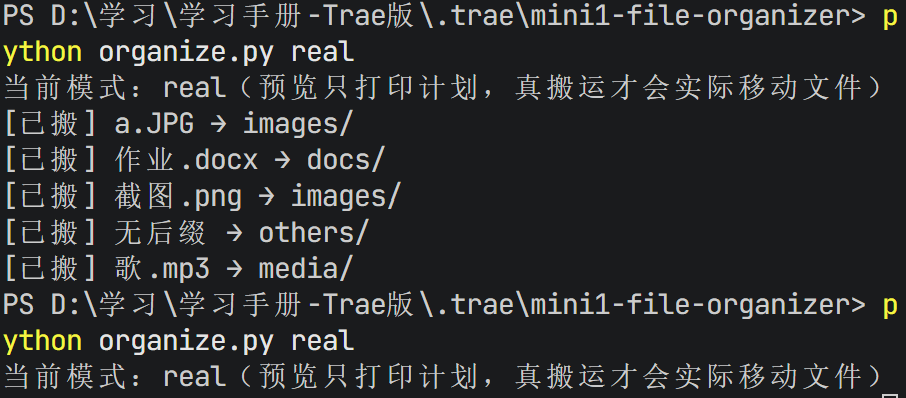

# Mini-1 文件整理器

## 背景

把 `test_mess/` 里的一堆杂文件按扩展名自动归到 `images / docs / media / others` 四个文件夹，省得在资源管理器里一个个手动拖。先用预览模式看清"哪个文件搬到哪"，确认没问题再执行真搬运。

## 怎么跑

脚本里扫描的目录是写死的 `Path("test_mess")`，所以要放在含有 `test_mess/` 的目录下运行：

```bash
python organize.py        # 预览模式：只打印搬运计划，不动任何文件
python organize.py real   # 真搬运：建目录后实际移动文件
```

分类规则：`.jpg / .png` → `images`，`.pdf / .txt / .docx` → `docs`，`.mp4 / .mp3` → `media`，其余（含无后缀）→ `others`。

## 截图

【截图存到 assets/ 目录后，删掉这两行括号说明，保留下面两行图片引用】




## 我踩过的坑

- **`shutil.move` 传 `Path` 对象会报错**：在我这台机器上它只接受字符串路径，所以两处都套了 `str()`——`shutil.move(str(f), str(target_file))`。
- **在 `mini1-file-organizer` 目录里执行 `git commit` 报 `not a git repository`**：终端不在仓库根目录时 git 找不到 `.git`。改用 `git -C <仓库绝对路径> add/commit/push`，不用先 cd。
- **v1 真搬运跑完把 `test_mess/` 搬空，再测预览一个字都不输出**：不是程序坏了，是源目录已经空了没文件可扫。测真搬运前要先把测试文件重建回 `test_mess/`。
- **无后缀文件不能靠 `Path.suffix` 判断**：`Path("无后缀").suffix` 返回空字符串，查表取不到值，所以用 `Map.get(ext, "others")` 兜底归到 `others`。
