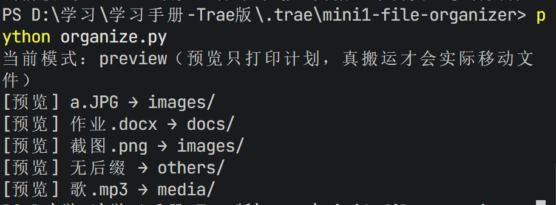

# Mini-1 文件整理器

## 背景

把 `test_mess/` 里的杂文件自动归类：先按扩展名分到 `images / docs / media / others` 四类，再按文件修改时间放进 `YYYY-MM` 日期子目录，省得在资源管理器里一个个手动拖。先用预览模式看清“哪个文件搬到哪”，确认没问题再执行真搬运。

## 怎么跑

在项目根目录打开终端，运行：

```bash
python organize.py        # 预览模式：只打印搬运计划，不动任何文件
python organize.py real   # 真搬运：建立目录、实际移动文件并写入日志
```

脚本通过 `BASE = Path(__file__).parent` 定位自身所在的项目目录，扫描的是项目里的 `test_mess/`，不依赖终端当前所在的目录。

### 分类规则

- `.jpg / .png` → `images`
- `.pdf / .txt / .docx` → `docs`
- `.mp4 / .mp3` → `media`
- 其余文件（包括无后缀文件）→ `others`

程序读取文件的修改时间，生成 `YYYY-MM` 格式的日期子目录。最终目录结构为：

```text
images/
└── 2026-11/
    └── 示例图片.jpg
docs/
└── 2026-10/
    └── 示例文档.txt
```

预览输出示例：

```text
[预览] 示例图片.jpg → images/2026-11/
```

确认真搬运后，文件才会被移动到对应目录。

### 搬运日志

只有真搬运模式会写日志。日志文件是项目根目录下的 `organize.log`，使用 UTF-8 编码，以追加方式写入，不会清空之前的记录。

每条日志的格式为：

```text
时间 | 文件名 | 目标目录
```

示例：

```text
2026-11-16 15:30:00 | 示例图片.jpg | images/2026-11/
```

## 截图




## 我踩过的坑

- **`shutil.move` 传 `Path` 对象会报错**：在我这台机器上它只接受字符串路径，所以两处都套了 `str()`——`shutil.move(str(f), str(target_file))`。
- **在 `mini1-file-organizer` 目录里执行 `git commit` 报 `not a git repository`**：终端不在仓库根目录时 git 找不到 `.git`。改用 `git -C <仓库绝对路径> add/commit/push`，不用先 cd。
- **v1 真搬运跑完把 `test_mess/` 搬空，再测预览一个字都不输出**：不是程序坏了，是源目录已经空了没文件可扫。测真搬运前要先把测试文件重建回 `test_mess/`。
- **无后缀文件不能靠 `Path.suffix` 判断**：`Path("无后缀").suffix` 返回空字符串，查表取不到值，所以用 `Map.get(ext, "others")` 兜底归到 `others`。
